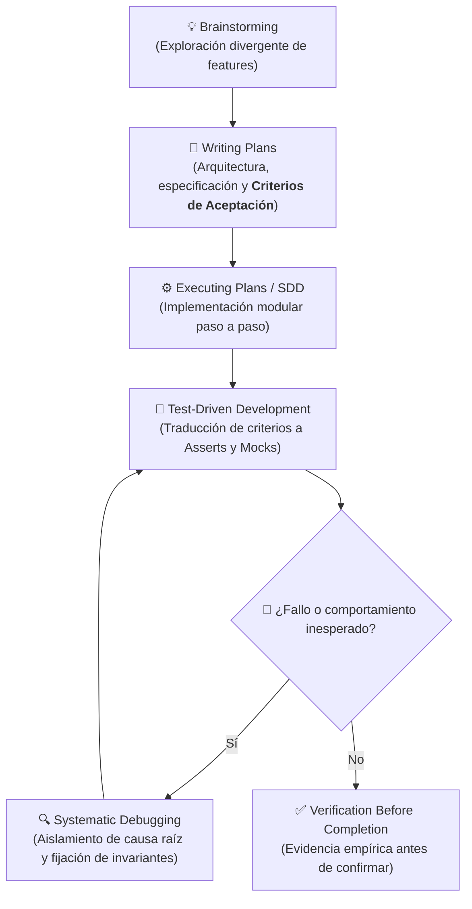

# Documentación del Flujo Superpowers y Suite de Pruebas

Este documento detalla cómo se aplicó la metodología y el conjunto de habilidades de **Superpowers** a lo largo del desarrollo de **Chess Vision Assistant**, la procedencia exacta de los criterios de aceptación, y la ubicación en el código de las **20 pruebas automatizadas** que componen la suite del proyecto.

---

## 1. El Flujo Superpowers en el Ciclo de Vida del Proyecto

El desarrollo siguió un enfoque disciplinado guiado por los principios de Superpowers: **planificación antes de codificar, diagnóstico sistemático basado en evidencia, desarrollo guiado por pruebas (TDD) y verificación rigurosa antes de completar cada tarea**.



### 1.1. `superpowers:brainstorming`
- **Propósito**: Responder al *"¿Qué problema queremos resolver?"* y *"¿Qué experiencia de usuario buscamos?"*.
- **Aplicación**:
  - Se propusieron alternativas creativas y no convencionales (HUD de simulación en vivo, conversor de partidas PGN en ejercicios interactivos, tablero fantasma predictivo).
  - El usuario seleccionó las dos más potentes: **simulación de jugadas en vivo mediante flechas con clic derecho** y **revisión/práctica activa de partidas PGN**.
  - **Nota clave**: En esta fase **no** se escriben los tests ni los umbrales numéricos; solo se define el alcance y la intención de uso.

### 1.2. `superpowers:writing-plans` (Origen de los Criterios de Aceptación)
- **Propósito**: Responder al *"¿Cómo se implementará técnicamente y bajo qué criterios exactos se considerará aprobada la feature?"*.
- **Aplicación**:
  - Aquí es **donde nacieron los criterios de aceptación formales** que posteriormente se tradujeron a código de prueba:
    1. **Plan de Simulación en Vivo**:
       - *Criterio cuantitativo*: Comparar la jugada candidata con la óptima calculando $\Delta\text{eval}$ en peones. Clasificar en 5 niveles exactos: `EXCELENTE` ($\le 0.25$), `BUENA` ($\le 0.65$), `IMPRECISIÓN` ($\le 1.50$), `ERROR` ($\le 2.80$), `COLGADA` ($> 2.80$).
       - *Criterio de rendimiento*: Tiempo de respuesta $\le 0.15\text{ s}$ por jugada con caché por FEN+Move.
       - *Criterio de concurrencia*: Cero bloqueos en Pygame (60 FPS) usando un hilo en segundo plano con `Lock` hacia Stockfish.
       - *Criterio de interacción*: Al soltar el clic o devolver la pieza a origen, el estado debe desaparecer sin alterar la partida.
    2. **Especificación de Revisión y Práctica PGN**:
       - *Criterio de filtrado*: Detectar hasta 3 errores del bando seleccionado con caídas de evaluación $\ge 0.5$ peones.
       - *Criterio de tolerancia táctica*: Usar Stockfish con `multipv=5`. Aceptar una jugada distinta a la del motor como «Buena alternativa» si su evaluación está dentro de **0.25 peones** de la mejor.
       - *Criterio de consulta bajo demanda*: Si el usuario intenta una jugada legal que no quedó en las 5 de MultiPV, consultarla al vuelo con `root_moves=[mejor, intento]`.
       - *Criterio de mate forzado*: Una alternativa no es válida si desperdicia un jaque mate forzado para ganar solo material.
       - *Criterio de interfaz y orientación*: Poder practicar con clic derecho incluso con el tablero invertido (negras abajo).

### 1.3. `superpowers:systematic-debugging`
- **Propósito**: Resolver fallos complejos mediante aislamiento metódico de causa raíz en lugar de prueba y error.
- **Casos de depuración aplicados**:
  1. **Inversión de evaluación y falsos "Error grave"**:
     - *Causa raíz*: Disparidad de escalas (centipeones enteros vs peones decimales con divisor 100) y perspectiva fija en blancas en vez de `score.pov(board.turn)`.
     - *Solución*: Normalización estricta por bando y atajo directo ($\Delta = 0.0$, `🟢 ¡MEJOR JUGADA!`) al trazar la recomendación del motor.
  2. **Bloqueo en `"DIBUJANDO FLECHA DESDE c1..."`**:
     - *Causa raíz*: Colisión concurrente en la tubería UCI de `SimpleEngine` entre el hilo de visión y el de simulación.
     - *Solución*: Protección con `self.engine_lock`, función de auto-recuperación `asegurar_motor()` y retornos de contingencia.
  3. **Error en flechas de caballo (`G1 → G2` en lugar de `G1 → H3`)**:
     - *Causa raíz*: Piezas intermedias cortaban la máscara naranja de Chess.com en dos componentes conexos independientes.
     - *Solución*: Cerrado morfológico (`cv2.morphologyEx`) y cálculo del diámetro máximo del contorno para unir base y punta real.

### 1.4. `superpowers:verification-before-completion`
- Cada funcionalidad se validó contra suites unitarias y pruebas de integración con aserciones estrictas antes de dar la tarea por concluida.

---

## 2. Dónde están los 20 Tests en el Código

Los **20 tests** están organizados en 4 archivos dentro del directorio [`tests/`](../../tests/):

```text
tests/
├── test_revision_pgn.py           --> 6 tests (Análisis PGN, MultiPV, mates y caídas)
├── test_interfaz_revision_pgn.py  --> 1 test  (Simulación visual headless en Pygame)
├── test_evaluador_simulacion.py   --> 7 tests (Evaluador, normalización POV, deltas y colgadas)
└── test_vision_y_motor.py         --> 6 tests (Visión CV2, flechas en L, concurrencia y resiliencia)
```

### 2.1. [`tests/test_revision_pgn.py`](../../tests/test_revision_pgn.py) (6 tests)

| # | Método del Test | Criterio de Aceptación Verificado |
| :-: | :--- | :--- |
| **1** | `test_multipv_acepta_lineas_cercanas_para_negras` | MultiPV 5 variantes, tolerancia de 0.25 peones, perspectiva de Negras y ocultamiento de solución en práctica. |
| **2** | `test_intento_fuera_de_la_lista_puede_aceptarse` | Consulta al vuelo con `root_moves` para jugadas fuera del top 5. |
| **3** | `test_alternativa_no_cuenta_si_pierde_un_mate_forzado` | Rechazo estricto si una alternativa omite un jaque mate forzado (`Mate(1)`). |
| **4** | `test_carga_primera_partida_y_rechaza_archivo_vacio` | Soporte UTF-8 con BOM (`utf-8-sig`) y excepción `ValueError` en archivos vacíos. |
| **5** | `test_devuelve_tres_caidas_del_bando_elegido` | Selección exacta de las 3 peores caídas ($\ge 0.5$ peones) ordenadas por severidad. |
| **6** | `test_revelar_y_practicar_reutiliza_la_posicion_original` | Reversión fiel al paso 0 y persistencia del estado entre modos de variantes y práctica. |

### 2.2. [`tests/test_interfaz_revision_pgn.py`](../../tests/test_interfaz_revision_pgn.py) (1 test)

| # | Método del Test | Criterio de Aceptación Verificado |
| :-: | :--- | :--- |
| **7** | `test_practica_por_flecha_con_tablero_invertido` | Simulación headless en Pygame (`SDL_VIDEODRIVER=dummy`) de trazo de flecha con clic derecho con el tablero invertido. |

### 2.3. [`tests/test_evaluador_simulacion.py`](../../tests/test_evaluador_simulacion.py) (7 tests)

| # | Método del Test | Criterio de Aceptación Verificado |
| :-: | :--- | :--- |
| **8** | `test_mejor_jugada_coincidente_retorna_delta_cero` | Coincidencia directa con mejor jugada: $\Delta = 0.0$, `verdict == 'EXCELENTE'` y badge `🟢 ¡MEJOR JUGADA!`. |
| **9** | `test_jugada_dudosa_blancas_calcula_delta_positivo` | Jugada pasiva/dudosa de blancas (`f2f3`) genera pérdida medible ($\Delta = 1.00$, `IMPRECISIÓN`). |
| **10** | `test_mejor_jugada_negras_normaliza_pov_correctamente` | Mejor jugada de negras (`c7c5`) evalúa con signo normalizado desde el POV de negras ($\Delta = 0.0$). |
| **11** | `test_jugada_erronea_negras_detecta_perdida` | Jugada errónea de negras (`f7f6`) detecta pérdida de iniciativa ($\Delta = 1.16$, `IMPRECISIÓN`). |
| **12** | `test_colgada_grave_asigna_veredicto_colgada_y_refutacion` | Regalo de pieza colgada (`f3e5`) genera $\Delta > 4.0$, `COLGADA` y explicación de refutación del rival (`Cxe5`). |
| **13** | `test_movimiento_no_legal_o_fuera_de_turno` | Movimientos prohibidos o fuera de turno son interceptados como `NO_LEGAL`. |
| **14** | `test_jaque_mate_directo_usuario_retorna_mate` | Jaque mate directo del usuario retorna de inmediato $\Delta = 0.0$ y badge `🟢 ¡JAQUE MATE!`. |

### 2.4. [`tests/test_vision_y_motor.py`](../../tests/test_vision_y_motor.py) (6 tests)

| # | Método del Test | Criterio de Aceptación Verificado |
| :-: | :--- | :--- |
| **15** | `test_deteccion_flecha_caballo_en_l_con_corte_morfologico` | Flecha en "L" de caballo (`G1 → H3`) segmentada correctamente mediante cerrado morfológico aún con pieza cortando la franja. |
| **16** | `test_deteccion_flecha_recta_peon` | Detección de avance recto de peón (`E2 → E4`) vinculando extremos de contorno. |
| **17** | `test_deteccion_tablero_sin_flechas_retorna_vacio` | Tablero sin flechas no genera falsos positivos y retorna lista vacía `[]`. |
| **18** | `test_seguridad_concurrente_engine_lock` | Acceso simultáneo multihilo protegido por `self.engine_lock` sin excepciones de tubería UCI. |
| **19** | `test_asegurar_motor_reconecta_tras_fallo` | Detección automática de proceso caído (`ping` fallido) y relanzamiento transparente de Stockfish. |
| **20** | `test_compilacion_y_sintaxis_de_modulos` | Verificación de compilación estática (`py_compile`) sobre todos los módulos del núcleo. |

---

## 3. Comandos para Ejecutar las 20 Pruebas

Ejecutá este comando desde la raíz del repositorio.

```powershell
.\.venv\Scripts\python.exe -B -m unittest discover -s tests -v
```

Salida de la ejecución:
```text
test_colgada_grave_asigna_veredicto_colgada_y_refutacion (test_evaluador_simulacion.EvaluadorSimulacionTest...) ... ok
test_jaque_mate_directo_usuario_retorna_mate (test_evaluador_simulacion.EvaluadorSimulacionTest...) ... ok
test_jugada_dudosa_blancas_calcula_delta_positivo (test_evaluador_simulacion.EvaluadorSimulacionTest...) ... ok
test_jugada_erronea_negras_detecta_perdida (test_evaluador_simulacion.EvaluadorSimulacionTest...) ... ok
test_mejor_jugada_coincidente_retorna_delta_cero (test_evaluador_simulacion.EvaluadorSimulacionTest...) ... ok
test_mejor_jugada_negras_normaliza_pov_correctamente (test_evaluador_simulacion.EvaluadorSimulacionTest...) ... ok
test_movimiento_no_legal_o_fuera_de_turno (test_evaluador_simulacion.EvaluadorSimulacionTest...) ... ok
test_practica_por_flecha_con_tablero_invertido (test_interfaz_revision_pgn.InterfazRevisionPGNTest...) ... ok
test_alternativa_no_cuenta_si_pierde_un_mate_forzado (test_revision_pgn.RevisionPGNTest...) ... ok
test_carga_primera_partida_y_rechaza_archivo_vacio (test_revision_pgn.RevisionPGNTest...) ... ok
test_devuelve_tres_caidas_del_bando_elegido (test_revision_pgn.RevisionPGNTest...) ... ok
test_intento_fuera_de_la_lista_puede_aceptarse (test_revision_pgn.RevisionPGNTest...) ... ok
test_multipv_acepta_lineas_cercanas_para_negras (test_revision_pgn.RevisionPGNTest...) ... ok
test_revelar_y_practicar_reutiliza_la_posicion_original (test_revision_pgn.RevisionPGNTest...) ... ok
test_asegurar_motor_reconecta_tras_fallo (test_vision_y_motor.VisionYMotorTest...) ... ok
test_compilacion_y_sintaxis_de_modulos (test_vision_y_motor.VisionYMotorTest...) ... ok
test_deteccion_flecha_caballo_en_l_con_corte_morfologico (test_vision_y_motor.VisionYMotorTest...) ... ok
test_deteccion_flecha_recta_peon (test_vision_y_motor.VisionYMotorTest...) ... ok
test_deteccion_tablero_sin_flechas_retorna_vacio (test_vision_y_motor.VisionYMotorTest...) ... ok
test_seguridad_concurrente_engine_lock (test_vision_y_motor.VisionYMotorTest...) ... ok

----------------------------------------------------------------------
Ran 20 tests in 0.347s

OK
```
